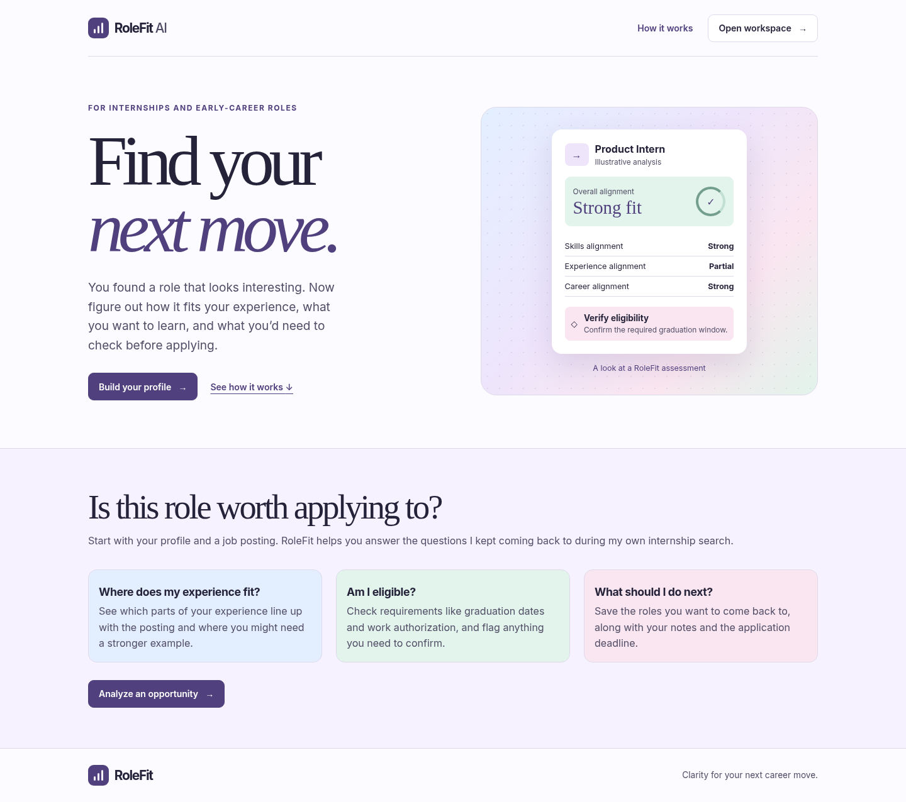
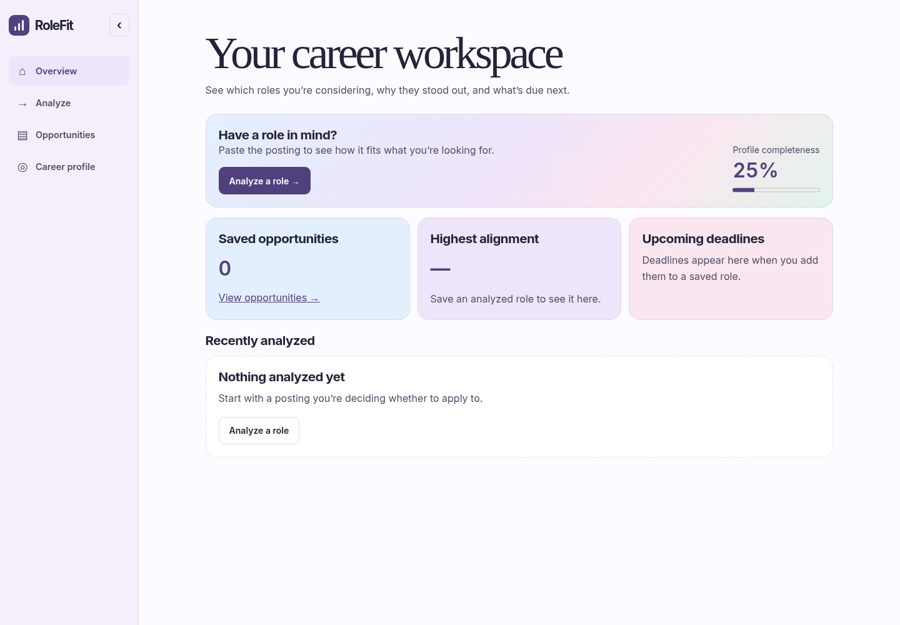

# RoleFit AI

**Find your next move.**

RoleFit helps you figure out which internships and early-career roles are worth applying to.



## Why I built it

When I was applying for internships, I kept asking myself the same questions. Does my experience fit? Am I eligible? What would I highlight if I applied? I wanted one place to work through those questions and keep track of the roles I actually wanted to pursue.

That’s why I built RoleFit. You bring a job posting and your experience, and it helps you see where you fit, what you still need to verify, and what to do next.

## How I’d use it

1. **Start with my profile.** I add my experience, the types of roles I’m looking for, and what matters to me in my next role.
2. **Try a real posting.** I paste the job description and look at what matches, where I might need a stronger example, and which eligibility requirements I should check.
3. **Save the roles I want to revisit.** I keep the assessment, deadline, and my notes together so I can pick up where I left off.



[See the mobile layout](docs/screenshots/landing-mobile.png) · [See an example assessment](docs/screenshots/analysis-example.png)

## Run locally

Use Node.js 22.12+ or Node.js 24 and npm.

```sh
npm ci
cp .env.example .env
npm start
```

In a second terminal, run `npm run dev` and open the URL Vite prints. Vite proxies API requests to Express at port 3001.

Set `OPENAI_API_KEY` in the local `.env` to enable live analysis. `OPENAI_MODEL` defaults to `gpt-4.1-mini` and can be set to a model that supports structured outputs. OpenAI usage may incur charges. Profile setup, navigation, and the workspace run without an API key.

## Architecture and design

React and Vite render the landing page and workspace. I used pastel blue, mint, pink, and lilac across the site, with dark text for readability. Inter and the shared form, card, and navigation styles keep the landing page and workspace consistent. Responsive layouts keep the same workflow on smaller screens.

Express validates requests and sends consented analysis inputs to OpenAI with a server-side key. The model returns structured JSON. The server checks the response shape, verifies quoted alignment evidence against the supplied text, and derives the scores. No resume text is written to server logs. The API uses a request-size limit, a provider timeout, and a process-wide request and concurrency cap.

Profiles, up to eight recent analyses, and saved opportunities are stored in the current browser. The career profile screen can delete all RoleFit browser data. Browser storage is unencrypted and accessible to anyone with access to that browser profile. Use a trusted browser and consider removing contact details before submitting a resume. Deletion in RoleFit clears browser storage. OpenAI handles submitted information under its own API data policies.

## How I calculate fit

| Dimension | With selected priorities | Without selected priorities |
| --- | ---: | ---: |
| Skills | 35% | 45% |
| Experience | 30% | 40% |
| Career | 35% | 15% |

The model classifies each dimension using a rubric. **Limited** maps to 25, **partial** to 60, and **strong** to 90. **Unclear** and dimensions without a verified pair of excerpts remain unscored. The server normalizes the weighted average over the scored dimensions, rounds it to the nearest five, and reports the percentage of the original weight supported by evidence. Eligibility appears separately because a single requirement can determine whether you can apply. Review excerpts and verify important requirements in the original posting.

## How I tested it

```sh
npm test
npm run lint
npm run build
```

Tests cover scoring, missing or unsupported evidence, structured-response validation, and HTTP input validation. The browser workflow was checked in Chromium with a controlled analysis response. Automated axe checks covered the landing page, dashboard, and analysis screen. A configured provider key is needed to verify live model output and latency.

## What I’d build next

Run `npm run build` and then `NODE_ENV=production npm start` to serve the site and API together locally. The server binds to loopback by default. `HOST` and `PORT` configure the listener for a managed host.

I’d use this version for a local walkthrough or a private demo. Before opening it to public use, add authentication, per-user access and rate limits, server-side encrypted storage, and an approved hosting and data retention setup. The browser version has no cross-device sync. Posting imports use pasted text. The posting URL is recorded for reference. Comparison views and a dedicated application tracker are future phases.
